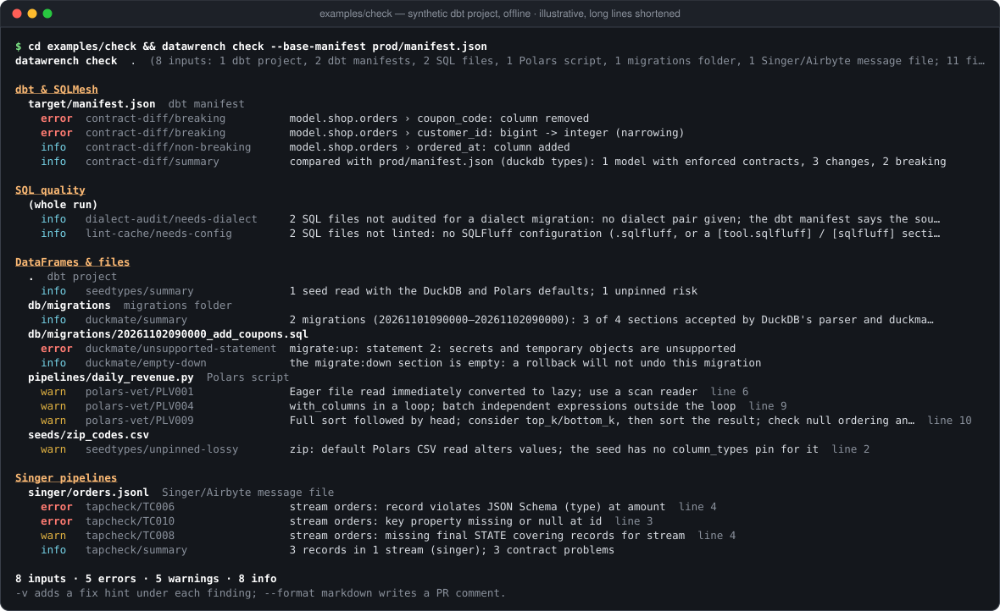

<p align="center">
  <picture>
    <source media="(prefers-color-scheme: dark)" srcset="assets/logo-dark.svg">
    
  </picture>
</p>

<p align="center">
  <strong>Catch what will break your data pipeline before the warehouse does.</strong><br>
  One offline CLI that reads your dbt project, SQL, joins, seeds, Parquet, Polars code and Singer output, and tells you what is about to go wrong.
</p>

<p align="center">
  <a href="https://github.com/tianhaogutum/datawrench/actions/workflows/ci.yml"></a>
  <a href="pyproject.toml"></a>
  <a href="LICENSE"></a>
</p>

<p align="center">
  English · <a href="README.zh-CN.md">简体中文</a>
</p>

<p align="center">
  <strong>Point it at your repo. Breaking dbt contract changes, joins that multiply rows, seeds that lose leading zeros, drifting Parquet schemas, slow Polars code, untranslatable SQL and broken tap output: sixteen tools in one install, one read-only report.</strong>
</p>

```sh
uvx 'datawrench[all]' check .          # or: pipx install 'datawrench[all]'
```

<p align="center">
  
</p>
<p align="center"><sub>Illustrative: drawn in the output format of <code>datawrench check</code> on the synthetic project in <a href="examples/check/"><code>examples/check</code></a>, long lines shortened. The key lines are pinned by <a href="tests/check/test_cli.py"><code>tests/check/test_cli.py</code></a>.</sub></p>

## Quick start

```sh
uvx 'datawrench[all]' check .                                     # read-only scan of a data repo
uvx 'datawrench[all]' check . --base-manifest prod/manifest.json  # + breaking dbt contract changes
uvx 'datawrench[all]' check target/compiled --dialect snowflake:duckdb   # + dialect migration audit
uvx 'datawrench[all]' check . --format markdown >> "$GITHUB_STEP_SUMMARY"
uvx 'datawrench[all]' check . --format sarif > datawrench.sarif   # SARIF 2.1.0 for code scanning
```

No warehouse, no credentials, no dbt run, no config. `check` recognises inputs by their content (a `dbt_project.yml`, a `manifest.json`, SQL, Python that imports Polars, CSV, Parquet, dbmate migrations, TableProof join contracts, grain contracts, Singer JSONL and catalogs), so you can point it at the whole repository.

> **Not on PyPI yet.** Until the first release, install from Git:
> `pipx install 'datawrench[all] @ git+https://github.com/tianhaogutum/datawrench'` or
> `uvx --from 'datawrench[all] @ git+https://github.com/tianhaogutum/datawrench' datawrench check .`
> (Python 3.11+, Linux and macOS).

Try it on the demo project from a clone:

```sh
git clone https://github.com/tianhaogutum/datawrench && cd datawrench/examples/check
uv run --project ../.. --extra all datawrench check --base-manifest prod/manifest.json
```

## Before and after

| You shipped | What happens next | `datawrench check` says |
| --- | --- | --- |
| `orders.customer_id` changed from `bigint` to `integer` | Downstream models and BI queries against the contract break | `error contract-diff/breaking ... bigint -> integer (narrowing)` |
| A ZIP code seed with no `column_types` | `02134` lands in the warehouse as `2134` | `warn seedtypes/unpinned-lossy zip: default Polars CSV read alters values` |
| A tap that emits a record without its key | The loader rejects or duplicates it | `error tapcheck/TC010 stream orders: key property missing or null at id` |
| `CREATE TEMP TABLE` in a migration | `duckmate up` stops at that migration | `error duckmate/unsupported-statement` |
| `with_columns` inside a `for` loop | One query plan per iteration | `warn polars-vet/PLV004 ... line 9` |
| A customer export where one `customer_id` appears twice | Every order joined to it is counted twice in revenue | `error join-witness/TP_RELATIONSHIP_VIOLATION` |
| A new `LEFT JOIN` in a model with a grain contract | Nobody declared whether it may fan out | `error grain-contract/invalid-contract` |
| A Parquet folder where `id` is `int32` in old files | A glob read fails or casts | `warn parquet-unify/widenable` (or `error type-conflict`) |

## What `check` runs

Each check calls the read-only Python API of one datawrench command; nothing is reimplemented, nothing is written. `datawrench check --list-checks` prints the list. Details, rule ids and the JSON schema: [docs/check.md](docs/check.md).

| Area | Check | Finds |
| --- | --- | --- |
| dbt & SQLMesh | `contract-diff` | Breaking changes to enforced model contracts against `--base-manifest` (removed columns, narrowed or incompatible types, dropped constraints) |
| | `sqlmesh-manifest` | SQLMesh projects: whether the exported dbt manifest validates, or the command to export one |
| SQL quality | `lint-cache` | SQLFluff violations under your own SQLFluff config (no cache written, dbt templater never run) |
| | `dialect-audit` | With `--dialect FROM:TO`: statements that will not parse or translate, unknown functions, unstable output |
| Keys & joins | `join-witness` | TableProof join contracts: relationship violations, many-to-many expansion, unmatched keys, rows above the contract caps |
| | `grain-contract` | Grain contracts next to a SELECT that no longer compile: undeclared joins, bad keys or grain |
| DataFrames & files | `polars-vet` | Eager reads turned lazy, Python lambdas, row loops, `with_columns`/`concat` in loops, `sort().head()` |
| | `parquet-unify` | Schema drift across the files of a Parquet folder: type conflicts, widenable types, missing columns |
| | `seedtypes` | Seed columns whose default DuckDB or Polars read changes the text and that are not pinned |
| | `duckmate` | dbmate-style DuckDB migrations that will not parse or that duckmate refuses; empty down sections |
| Singer pipelines | `tapcheck` | Missing or null primary keys, schema violations, undeclared streams, no final STATE |
| | `singer-replay` | Cassettes whose checksums, catalog or counts no longer match |

Exit 0 when clean, 1 when a finding reaches `--fail-on` (default `error`), 2 on usage errors. A check that crashes becomes one `internal` finding; the others still run. A missing optional dependency becomes one info finding with the install command.

### In CI

```yaml
- name: Check the data repo
  run: |
    uvx 'datawrench[all]' check . --base-manifest prod/manifest.json --format markdown >> "$GITHUB_STEP_SUMMARY"
    uvx 'datawrench[all]' check . --base-manifest prod/manifest.json --fail-on error
```

The first run writes a Markdown report to the job summary (also fine as a PR comment); the second fails the step on errors. Fetch `prod/manifest.json` from your last production run, the manifest in the folder you would pass to dbt `--state`.

## Then fix it: the commands behind the checks

`check` tells you what is wrong. These commands, all in the same install, do the work. Every one is offline.

| Group | Command | What it does | Extra |
| --- | --- | --- | --- |
| dbt & SQLMesh | `contract-diff` | Type-aware compatibility gate between two dbt manifests, nested types included | `[sqlglot]` |
| | `sqlmesh-manifest` | Export a SQLMesh project as a dbt manifest v12; validate and diff it | `[sqlmesh]` |
| SQL quality | `lint-cache` | Content-addressed cache for SQLFluff: re-lint only what changed | `[sqlfluff]` |
| | `dialect-audit` | Per-statement dialect migration report, with DuckDB binding against empty tables | `[sqlglot,duckdb]` |
| | `rebuild-check` | Rehearse SQLite migrations on a disposable backup; fail when a table rebuild dropped a trigger, index, view, foreign key or constraint (also a sqlite-utils plugin) | `[sqlite]` |
| Keys & joins | `join-witness` | Rank the source records that multiply a join and trace how each one inflates a sum; emit DuckDB assertions | `[tableproof]` |
| | `grain-contract` | Compile a SELECT plus primary keys and per-join grain intentions into zero-row SQL tests; dbt singular tests from the compiled manifest | `[sqlglot,ijson]` (+`[duckdb]` to run) |
| | `key-audit` | Preview Unicode cleanup (NFC, width, strip, casefold…) on CSV join keys: separate existing duplicates from new collisions, then export only confirmed rules | `[ftfy]` |
| DataFrames & files | `polars-vet` | Static Polars performance checks, `--fix` for safe rewrites, also a flake8 plugin | |
| | `parquet-unify` | Plan a lossless common schema; generate DuckDB and Polars readers; rewrite and verify | `[parquet,duckdb,polars]` |
| | `seedtypes` | Infer CSV types that keep every value; emit dbt `column_types`, DuckDB or Polars readers | `[duckdb,polars,sqlglot]` |
| | `duckmate` | dbmate-format DuckDB migrations with schema snapshots and drift verification | `[duckdb]` |
| | `csv-rewind` | Show which CSV cells a proposed DuckDB schema changes; recommend safe types and verified read SQL | `[duckdb]` |
| | `failurepack` | Shrink a CSV to a replayable bundle that still triggers one chosen Pandera failure | `[pandera]` (Python 3.12+) |
| Singer pipelines | `tapcheck` | Streaming contract and quality checks for Singer and Airbyte JSONL; convert between them | `[singer]` |
| | `singer-replay` | Record a scrubbed tap cassette once, replay it as a credential-free tap | |

```sh
datawrench contract-diff --base prod/manifest.json --head target/manifest.json --format markdown
datawrench seedtypes emit seeds/zip_codes.csv --target dbt --adapter snowflake
datawrench parquet-unify plan lake/orders --explain
datawrench tapcheck validate singer/orders.jsonl --strict --check-duplicates
datawrench join-witness --config tableproof.toml --audit orders-to-customers --left-measure amount
datawrench grain-contract compile models/orders.sql orders.contract.json --out tests/grain_orders
datawrench rebuild-check app.db migrations/0042_rebuild.sql
```

The core install needs only PyYAML. Extras pull in the heavy dependencies: `[sqlglot]`, `[duckdb]`, `[polars]`, `[parquet]` (pyarrow), `[sqlfluff]`, `[singer]` (jsonschema), `[sqlite]` (sqlite-utils, sqlparse), `[tableproof]`, `[ijson]`, `[ftfy]`, or `[all]` for all of them. Two extras are separate: `[sqlmesh]` pins SQLMesh's own sqlglot version (`pipx install 'datawrench[all,sqlmesh]'`), and `[pandera]` (Pandera, pandas, dfshrink) is heavy and needs Python 3.12+ (`pipx install 'datawrench[pandera]'`). `datawrench <command> --help` lists every option.

## Trust and limits

- **Offline, no telemetry.** datawrench opens no network connections and needs no warehouse credentials.
- **Read-only by default.** `check` and the analysis subcommands never modify inputs; `check` does not even create a lint cache. Commands that write need an explicit output path.
- **Nothing is executed by `check`.** No dbt run, no model, no tap, no migration. SQL is parsed (and, on request, bound with `EXPLAIN` against empty in-memory tables), never run. The dbt templater and SQLMesh Python models run only when you pass the explicit trust flag to their own command. The commands that do execute say so: `rebuild-check` applies migrations to a temporary backup copy only, `grain-contract check` runs its generated read-only queries against the DuckDB file you name, and `failurepack` runs your Pandera schema on candidate CSVs in a subprocess.
- **No data in `check` reports.** Findings name files, columns, streams, joins and line numbers, not record values, keys or CSV fields. The commands you run to investigate (`join-witness`, `key-audit`, `csv-rewind`) show the keys or cells involved, locally, because that is their job.
- **Strict inputs.** Each tool reads a documented format and says why when it refuses an input. It does not guess.
- **Files, not your warehouse.** A contract diff compares two manifests; seed checks compare CSV text with what default readers produce locally; Parquet checks read footers only.

datawrench is independent and not affiliated with dbt Labs, Tobiko (SQLMesh), SQLFluff, SQLGlot, DuckDB, Polars, Apache Arrow, Singer, Meltano, Airbyte, TableProof, Pandera, sqlite-utils or ftfy.

---

<p align="center">If datawrench caught a breaking change before your warehouse did, a star helps other data engineers find it.</p>
