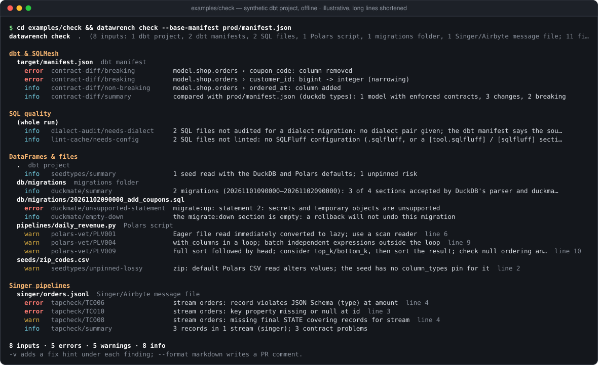

<p align="center">
  <picture>
    <source media="(prefers-color-scheme: dark)" srcset="assets/logo-dark.svg">
    
  </picture>
</p>

<p align="center">
  <strong>在数据仓库出问题之前，先发现数据管道里要坏的地方。</strong><br>
  一个离线命令行工具：读取你的 dbt 项目、SQL、join、种子 CSV、Parquet、Polars 代码和 Singer 输出，告诉你哪里马上要出错。
</p>

<p align="center">
  <a href="https://github.com/tianhaogutum/datawrench/actions/workflows/ci.yml"></a>
  <a href="pyproject.toml"></a>
  <a href="LICENSE"></a>
</p>

<p align="center">
  <a href="README.md">English</a> · 简体中文
</p>

<p align="center">
  <strong>对准你的仓库运行一次。破坏性的 dbt 契约变更、让行数翻倍的 join、丢掉前导零的种子、漂移的 Parquet schema、慢的 Polars 写法、无法翻译的 SQL、有问题的 tap 输出：一次安装十六个工具，一份只读报告。</strong>
</p>

```sh
uvx 'datawrench[all]' check .          # 或者：pipx install 'datawrench[all]'
```

<p align="center">
  
</p>
<p align="center"><sub>示意图：按 <code>datawrench check</code> 的输出格式手工绘制，数据来自 <a href="examples/check/"><code>examples/check</code></a> 中的合成项目，长行已截断。关键行由 <a href="tests/check/test_cli.py"><code>tests/check/test_cli.py</code></a> 固定。</sub></p>

## 快速开始

```sh
uvx 'datawrench[all]' check .                                     # 只读扫描一个数据仓库
uvx 'datawrench[all]' check . --base-manifest prod/manifest.json  # 再检查破坏性的 dbt 契约变更
uvx 'datawrench[all]' check target/compiled --dialect snowflake:duckdb   # 再审计方言迁移
uvx 'datawrench[all]' check . --format markdown >> "$GITHUB_STEP_SUMMARY"
uvx 'datawrench[all]' check . --format sarif > datawrench.sarif   # 用于代码扫描的 SARIF 2.1.0
```

不需要数据仓库、凭据、dbt 运行或配置。`check` 按内容识别输入（`dbt_project.yml`、`manifest.json`、SQL、导入 Polars 的 Python、CSV、Parquet、dbmate 迁移、TableProof join 契约、粒度契约、Singer JSONL 和 catalog），所以可以直接对整个仓库运行。

> **尚未发布到 PyPI。** 首个版本发布前，请从 Git 安装：
> `pipx install 'datawrench[all] @ git+https://github.com/tianhaogutum/datawrench'` 或
> `uvx --from 'datawrench[all] @ git+https://github.com/tianhaogutum/datawrench' datawrench check .`
> （Python 3.11+，Linux 和 macOS）。

在克隆下来的仓库里试运行示例项目：

```sh
git clone https://github.com/tianhaogutum/datawrench && cd datawrench/examples/check
uv run --project ../.. --extra all datawrench check --base-manifest prod/manifest.json
```

## 之前与之后

| 你提交了 | 接下来会发生 | `datawrench check` 的输出 |
| --- | --- | --- |
| `orders.customer_id` 从 `bigint` 改成 `integer` | 依赖这个契约的下游模型和 BI 查询出错 | `error contract-diff/breaking ... bigint -> integer (narrowing)` |
| 没有 `column_types` 的邮编种子 | `02134` 进了仓库变成 `2134` | `warn seedtypes/unpinned-lossy zip: default Polars CSV read alters values` |
| tap 输出了一条没有主键的记录 | loader 拒收或产生重复 | `error tapcheck/TC010 stream orders: key property missing or null at id` |
| 迁移里写了 `CREATE TEMP TABLE` | `duckmate up` 在这个迁移处停下 | `error duckmate/unsupported-statement` |
| `for` 循环里调用 `with_columns` | 每次迭代生成一个查询计划 | `warn polars-vet/PLV004 ... line 9` |
| 客户导出文件里某个 `customer_id` 出现两次 | 关联到它的每笔订单在收入里被算两次 | `error join-witness/TP_RELATIONSHIP_VIOLATION` |
| 有粒度契约的模型里新加了一个 `LEFT JOIN` | 没人声明它是否允许扇出 | `error grain-contract/invalid-contract` |
| Parquet 目录里旧文件的 `id` 是 `int32` | glob 读取失败或被强制转换 | `warn parquet-unify/widenable`（或 `error type-conflict`） |

## `check` 会运行什么

每项检查都调用一个 datawrench 子命令的只读 Python API；不重新实现，也不写任何文件。`datawrench check --list-checks` 打印完整列表。细节、规则 id 和 JSON 格式见 [docs/check.md](docs/check.md)。

| 领域 | 检查 | 发现什么 |
| --- | --- | --- |
| dbt 与 SQLMesh | `contract-diff` | 相对 `--base-manifest`，强制模型契约的破坏性变更（删除列、类型收窄或不兼容、删除约束） |
| | `sqlmesh-manifest` | SQLMesh 项目：导出的 dbt manifest 是否有效，没有则给出导出命令 |
| SQL 质量 | `lint-cache` | 在你自己的 SQLFluff 配置下的违规（不写缓存，从不运行 dbt 模板器） |
| | `dialect-audit` | 给出 `--dialect FROM:TO` 时：无法解析或翻译的语句、未知函数、不稳定的输出 |
| 键与连接 | `join-witness` | TableProof join 契约：违反关系约束、多对多膨胀、未匹配的键、超出契约上限的行数 |
| | `grain-contract` | 与 SELECT 放在一起、已经无法编译的粒度契约：未声明的 join、错误的键或粒度 |
| DataFrame 与文件 | `polars-vet` | 急切读取后转 lazy、Python lambda、逐行循环、循环里的 `with_columns`/`concat`、`sort().head()` |
| | `parquet-unify` | 同一 Parquet 目录内文件之间的 schema 漂移：类型冲突、可放宽的类型、缺失列 |
| | `seedtypes` | DuckDB 或 Polars 默认读取会改变文本、又没有固定类型的种子列 |
| | `duckmate` | 无法解析或被 duckmate 拒绝的 dbmate 格式 DuckDB 迁移；空的 down 段 |
| Singer 管道 | `tapcheck` | 缺失或为 null 的主键、违反 schema、未声明的 stream、没有最终 STATE |
| | `singer-replay` | 校验和、catalog 或计数已经对不上的 cassette |

没有问题时退出码为 0，有发现达到 `--fail-on`（默认 `error`）时为 1，用法错误为 2。某项检查崩溃只会变成一条 `internal` 发现，其余检查照常运行。缺少可选依赖时变成一条带安装命令的 info。

### 在 CI 中

```yaml
- name: Check the data repo
  run: |
    uvx 'datawrench[all]' check . --base-manifest prod/manifest.json --format markdown >> "$GITHUB_STEP_SUMMARY"
    uvx 'datawrench[all]' check . --base-manifest prod/manifest.json --fail-on error
```

第一次运行把 Markdown 报告写进 job summary（也可以直接作为 PR 评论）；第二次在出现错误时让这一步失败。`prod/manifest.json` 取自最近一次生产运行，也就是你会传给 dbt `--state` 的那个目录里的 manifest。

## 然后修复：检查背后的命令

`check` 告诉你哪里有问题，下面这些命令负责解决，都在同一个安装包里，全部离线。

| 分组 | 命令 | 作用 | Extra |
| --- | --- | --- | --- |
| dbt 与 SQLMesh | `contract-diff` | 两个 dbt manifest 之间按类型判断的兼容性门禁，包括嵌套类型 | `[sqlglot]` |
| | `sqlmesh-manifest` | 把 SQLMesh 项目导出为 dbt manifest v12；校验并比较 | `[sqlmesh]` |
| SQL 质量 | `lint-cache` | SQLFluff 的内容寻址缓存：只重新 lint 改动过的文件 | `[sqlfluff]` |
| | `dialect-audit` | 逐语句的方言迁移报告，可对空表做 DuckDB 绑定检查 | `[sqlglot,duckdb]` |
| | `rebuild-check` | 在一次性备份上预演 SQLite 迁移；表重建丢失触发器、索引、视图、外键或约束时报错（也可作为 sqlite-utils 插件） | `[sqlite]` |
| 键与连接 | `join-witness` | 找出让 join 行数翻倍的原始记录，追踪它们如何放大求和结果；生成 DuckDB 断言 | `[tableproof]` |
| | `grain-contract` | 把 SELECT、主键和每个 join 的粒度约定编译成零行 SQL 测试；可从 dbt 编译后的 manifest 生成 singular tests | `[sqlglot,ijson]`（运行需 `[duckdb]`） |
| | `key-audit` | 预览 CSV 连接键的 Unicode 清洗（NFC、全半角、去空白、大小写折叠…）：区分原有重复与新增冲突，只导出确认过的规则 | `[ftfy]` |
| DataFrame 与文件 | `polars-vet` | 静态 Polars 性能检查，`--fix` 做安全改写，也可作为 flake8 插件 | |
| | `parquet-unify` | 规划无损的公共 schema；生成 DuckDB 和 Polars 读取代码；重写并验证 | `[parquet,duckdb,polars]` |
| | `seedtypes` | 推断保留每个值的 CSV 类型；生成 dbt `column_types`、DuckDB 或 Polars 读取代码 | `[duckdb,polars,sqlglot]` |
| | `duckmate` | dbmate 格式的 DuckDB 迁移，带 schema 快照和漂移校验 | `[duckdb]` |
| | `csv-rewind` | 显示拟定的 DuckDB 列类型会改变哪些 CSV 单元格原文；给出安全类型和经过验证的读取 SQL | `[duckdb]` |
| | `failurepack` | 把 CSV 缩减为仍能触发指定 Pandera 失败的可重放小包 | `[pandera]`（需 Python 3.12+） |
| Singer 管道 | `tapcheck` | Singer 和 Airbyte JSONL 的流式契约与质量检查；两者互相转换 | `[singer]` |
| | `singer-replay` | 录制一次脱敏的 tap cassette，之后作为无需凭据的 tap 回放 | |

```sh
datawrench contract-diff --base prod/manifest.json --head target/manifest.json --format markdown
datawrench seedtypes emit seeds/zip_codes.csv --target dbt --adapter snowflake
datawrench parquet-unify plan lake/orders --explain
datawrench tapcheck validate singer/orders.jsonl --strict --check-duplicates
datawrench join-witness --config tableproof.toml --audit orders-to-customers --left-measure amount
datawrench grain-contract compile models/orders.sql orders.contract.json --out tests/grain_orders
datawrench rebuild-check app.db migrations/0042_rebuild.sql
```

核心安装只依赖 PyYAML。较重的依赖放在 extra 里：`[sqlglot]`、`[duckdb]`、`[polars]`、`[parquet]`（pyarrow）、`[sqlfluff]`、`[singer]`（jsonschema）、`[sqlite]`（sqlite-utils、sqlparse）、`[tableproof]`、`[ijson]`、`[ftfy]`，或用 `[all]` 一次装全。有两个 extra 单独提供：`[sqlmesh]` 固定了 SQLMesh 自己的 sqlglot 版本（`pipx install 'datawrench[all,sqlmesh]'`）；`[pandera]`（Pandera、pandas、dfshrink）较重且需要 Python 3.12+（`pipx install 'datawrench[pandera]'`）。`datawrench <command> --help` 列出全部选项。

## 信任与边界

- **离线，无遥测。** datawrench 不建立任何网络连接，也不需要仓库凭据。
- **默认只读。** `check` 和各分析子命令从不修改输入；`check` 甚至不会创建 lint 缓存。会写文件的命令都要求显式给出输出路径。
- **`check` 不执行任何东西。** 不运行 dbt、模型、tap 或迁移。SQL 只解析（按需对内存中的空表做 `EXPLAIN` 绑定），从不执行。dbt 模板器和 SQLMesh Python 模型只在你对相应子命令显式传入信任参数时才会运行。会执行代码的命令都会明确说明：`rebuild-check` 只在临时备份副本上应用迁移，`grain-contract check` 在你指定的 DuckDB 文件上运行它生成的只读查询，`failurepack` 在子进程里用你的 Pandera schema 校验候选 CSV。
- **`check` 报告里没有数据。** 发现只写文件、列、stream、join 和行号，不写记录值、键或 CSV 字段。用来排查问题的命令（`join-witness`、`key-audit`、`csv-rewind`）会在本地显示相关的键或单元格，这正是它们的用途。
- **严格的输入。** 每个工具读取有文档说明的格式；拒绝某个输入时会说明原因，不靠猜。
- **看的是文件，不是你的仓库。** 契约比较的是两个 manifest；种子检查比较 CSV 文本和本地默认读取的结果；Parquet 检查只读文件尾部元数据。

datawrench 是独立项目，与 dbt Labs、Tobiko（SQLMesh）、SQLFluff、SQLGlot、DuckDB、Polars、Apache Arrow、Singer、Meltano、Airbyte、TableProof、Pandera、sqlite-utils 或 ftfy 均无隶属关系。

---

<p align="center">如果 datawrench 在你的数据仓库之前发现了一处破坏性变更，点个 star，能帮更多数据工程师找到它。</p>
